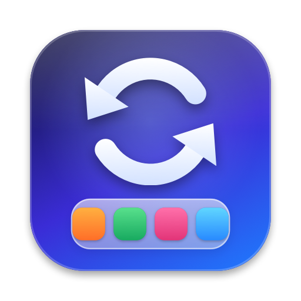

<p align="center"></p>

# MacSync

Keep all your Macs set up the same way: Dock layout, installed apps and, with Pro, settings.
Sync goes through your own iCloud Drive. There is no server.

Status: early access. It has been run on one Mac only, not yet across two physical Macs, and the
builds here are not signed or notarized yet. See [docs/RELEASING.md](docs/RELEASING.md).

## What it does

- **Dock:** apps, folders, spacers, links, order, position and size. Apps match by bundle ID,
  so they still line up when their paths differ between Macs.
- **Apps:** Homebrew casks and formulae, and Mac App Store apps. You tick what you want.
  MacSync never uninstalls anything.
- **Settings (Pro):** about 34 macOS settings (trackpad, keyboard, Finder, Dock behavior,
  appearance, screenshots), plus the preferences of apps you pick under the gear menu,
  App Preferences. A setting left at its default stays at its default.
- **Safety:** a preview before every apply, a restore point before every apply, and one-click undo.

Pro is behind a single switch, `ProLicense.enforced` in `Sources/MacSyncCore/Pro.swift`. It is
`false`, so Pro is on for everyone until you decide on pricing and add a license check.

## How sync works

Each Mac writes only its own file, `iCloud Drive/MacSync/machines/<id>.json`, so iCloud never
has to merge anything. MacSync checks every 5 minutes and on wake, and it saves this Mac's setup
when it changes. It doesn't change a Mac until you review and apply.

**When two Macs change the Dock or settings, the latest change wins.** The other Mac is offered
that version, and a restore point is saved before it applies. A newly added Mac never beats an
established one, because its starting setup doesn't count as an edit. If an app in the layout
isn't on this Mac, it is left out and listed. This relies on each Mac's clock.

Only an allowlist of fields is ever synced: names, bundle IDs, paths, Dock options, app lists and
the catalogued settings. Bookmarks stay on the Mac, your user folder is written as `~`, and logins
and secret-looking parameters are stripped from Dock links. App preferences you pick are filtered
too: anything that looks like a token, key or password is dropped.

## Build and run

Requires Xcode. The app runs on macOS 13 or later.

```bash
swift test
```

```bash
scripts/build-app.sh
```

```bash
open build/MacSync.app
```

## CLI

The CLI is inside the app, at `MacSync.app/Contents/Helpers/macsync`.

```text
macsync status             Show each Mac and whether it's in sync
macsync sync               Save this Mac's setup and check the others (changes nothing here)
macsync preview            Show what applying would change
macsync apply              Apply, after showing the preview and asking
    --yes                  Don't ask (required when not run from a terminal)
    --no-dock              Leave the Dock alone
    --no-settings          Leave settings alone
    --install a,b          Also install these (cask:ghostty,formula:jq,mas:497799835)
    --all-apps             Also install everything your other Macs have
macsync undo [--yes]       Undo the last apply
macsync app-prefs          List the app preference domains you sync (add|remove <domain>)
macsync restore-points     List saved restore points
```

## Raycast

`raycast/` has Sync Now, Apply Dock Layout, Undo Last Apply and Show Status. They call the same CLI.

```bash
cd raycast && npm install && npm run dev
```

## Good to know

- Mac App Store apps open on their App Store page for you to click Get. `mas install` needs root,
  so MacSync doesn't use it, and App Store IDs come from Spotlight, so it needs no extra tools.
- Casks that ask for an admin password fail and are reported, because MacSync never waits on a prompt.
- Undo restores the Dock and settings. Installed apps stay installed, and MacSync tells you which ones.
- Some settings (trackpad, keyboard, appearance) need a log out to fully take effect.

## Branding and the landing page

- `scripts/make-icon.swift` draws the app icon. `build-app.sh` turns it into `AppIcon.icns`.
- `scripts/make-screenshots.sh` renders the screenshots in `docs/assets/` from a made-up demo
  setup, light and dark, so no real names or apps appear in them.
- `docs/index.html` is the landing page: one static file that uses those images.

## Releasing

`scripts/release.sh` signs with a Developer ID certificate, notarizes, staples, zips, and fills in
the Homebrew cask from `packaging/macsync.rb.template`. It publishes nothing. The one-time setup
and the manual steps after it are in [docs/RELEASING.md](docs/RELEASING.md).

## Layout

- `Sources/MacSyncCore`: everything that matters, shared by the app and CLI
- `Sources/MacSyncApp`: the menu bar app
- `Sources/macsync`: the CLI
- `Tests/MacSyncCoreTests`: unit tests, using a simulated Dock and simulated preferences
- `packaging/`: the Homebrew cask template
- `docs/`: landing page and its images
